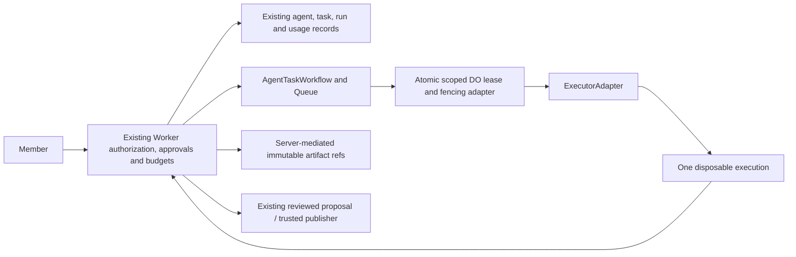

## D5565 — Portable workspace specification and a fenced executor run plane (#5565)

**Status:** host-independent contract implementation, unmounted and disabled. No deployment or account resource change. Verified against main `d927a92ae6` on 12 Nov 2026. D4554 is still a draft in #5596; this record does not approve that ADR or unblock #4557's host.

### Decision and existing ownership

The existing Worker/Hono application remains the privileged control plane, D1 the canonical store, `AgentTaskWorkflow`/Queue the task lifecycle, AgentScope DO the existing atomic-coordination boundary, and the current AI router/hold/settlement/usage path the only model policy and accounting path. Sources: CLAUDE.md, wrangler.toml, `src/agents/{runtime,taskWorkflow,loop}.ts`, D1528, D4557. One Worker serves both application hosts; Pages is retired and FastAPI is development only.

A persistent agent identity is not a running machine. A disposable execution belongs to one existing task/run/attempt/generation; dormant agents allocate no executor. Relocation means rebuilding from an acknowledged immutable checkpoint on an allowed provider, not moving a live process. The executor may return artifact references, not publish a PR, execute a proposal, charge a ledger or bypass human approval.

### Version 1 contract

`workspaceSpec.ts` supplies a strict runtime-validated TypeScript/Zod contract: tenant/company/project, existing agent/task/run, attempt and execution generation, scoped idempotency key, digest-only image, registered repository ID and exact SHA, bounded write paths/resources/time, network policy, allowed locations/providers, workload class, checkpoint/artifact refs and integer micro-USD ceiling. A client or runner may override **none** of these fields. The authorized broker assembles them from current records and policy. Extra keys, mutable tags, symbolic branch names, traversal/Git metadata scopes, non-finite resources and unknown versions are refused. The returned specification is deeply immutable.

Repository and object references are IDs, not URLs or storage credentials. `tenant_id` is an explicitly broker-resolved isolation identity, not a new tenancy or task table. A future route must verify its relationship to company/project/task/run in the existing authoritative stores; passing structural validation alone confers no authority.

Contract v1 accepts only its exact closed shape. Breaking fields or changed semantics require v2 and an explicit persisted-record upgrade/reader compatibility plan; unknown versions fail closed. Store references/ownership/version in D1, large files in R2 and atomic lease state in the scoped DO. This phase adds no migration or persistent ledger. The eventual host owns its DO storage adapter and migration.

### Capability and state semantics

`ExecutorAdapter` exposes capabilities, estimate, create, get, terminate, collect and cleanup. It uses `queued`, `provisioning`, `running`, `checkpointing`, `finished`, `failed`, `cancelling`, `cancelled`, `unknown`. Terminal states cannot return to running, and cancelling cannot become a successful completion. Estimates distinguish unmeasured from measured zero. The spec's cost ceiling does not reserve or settle anything; #5570 must reuse existing admission/accounting before actual execution.

Eligibility is explicit and fail-closed for provider, workload, digest pulls, shells, hostile-code containment, resource/time bounds, network enforcement, residency, checkpoint restore and verified capacity. Unknown capacity or an unenforceable region is not a successful placement. No silent fallback or security downgrade is permitted.

| Provider owner | Contract capability inventory / rollout boundary |
|---|---|
| #5566 — Cloudflare | First candidate; OCI/disk/CPU/RAM/runtime/region/network/isolation must match the pinned runtime and actual account. The fake's capabilities are synthetic, not a production assertion. |
| #5571 — Azure Container Apps Jobs | Registration, IAM, image pulls, shell/runtime, egress, residency, interrupt/checkpoint, GPU and measured concurrency remain unverified; disabled. |
| #5571 — Google Cloud Run Jobs | Same explicit capability inventory and consent gate; disabled, no inferred equivalence to Cloudflare. |
| #5571 — AWS ECS/Fargate | Same inventory, including task-role/network isolation and resource combinations; disabled. |
| #5572 — customer/BYOC | Independent trust zone; enrolment, attestation, revocation and enforceable policy required before eligibility. Disabled. |

Cloudflare source checks: [current scheduling policies](https://developers.cloudflare.com/containers/configuration/scheduling-policy/), [DO scheduling migration](https://developers.cloudflare.com/containers/guides/migrate-to-durable-object-scheduling-policy/), [limits](https://developers.cloudflare.com/containers/platform/limits/). Checked 12 Nov 2026 via the Cloudflare documentation connector. These documents describe platform defaults, not this account's provisioned capacity. The coding pilot uses the currently supported policy only after its separate review; this does not silently amend #4557's previously selected v1 policy.

### Pull-mode run protocol

`runnerProtocol.ts` implements `createRunnerControl({store, clock, policy})` with no D1, route, mount, model call or new scheduler. It registers a broker-created run and offers one atomic lease; the transport may long-poll around its immediate unavailable result. Heartbeats renew short expiry and reject repeated sequence numbers. A revocation or cancellation refusal tells the runner to stop. Replayed lease requests and wrong tenant/company/project/agent/task/runner identities are refused.

After exactly N missed beats, the old lease is removed and its generation fenced before the run becomes eligible for recovery. A replacement lease waits for the host to acknowledge cleanup, because a missing heartbeat does not prove a machine stopped. The wall deadline spans retries. Generation-bound upload and completion checks refuse old/mixed attempts; exact completion replay is idempotent only for the original runner/lease/manifest. The artifact broker must separately verify that immutable manifest's ownership/hash before invoking completion. No bytes are authorized by a prefix alone.

The store interface requires atomic transactions on one scoped record set; the memory implementation/fake executor live only under tests. A host must implement the same contract in DO storage rather than reuse a process-local Map. Requeue events return to the existing Workflow/Queue; this module launches no task. Ambiguous create/termination outcomes stay `unknown`: reconcile the deterministic execution reference, then confirm stop/cleanup before a new generation. Do not blindly create another execution.

### Trust boundaries and threats

Repository files, install scripts, command output and generated PR text are untrusted data; none may choose grants, modify broker scope, supply provider credentials, publish integrations or authorize a model call. #5567 owns issuance/audience/nonce/expiry, replay, digest/provenance policy, revoked sponsors, metadata/private-network denial, emergency halt, hostile-code eligibility and server-mediated object access. #5568 owns bounded checkout/archive/checkpoint/hash validation. #5569 owns the trusted GitHub publisher. #5570 owns placement, cost and quota reconciliation through existing stores.

No account-wide key, D1/admin binding or general R2 credential belongs in a coding container. A callback must pass both cryptographic grant validation and current authorization/revocation/generation checks. Object redemption and integration publishing require their own audience and existing permission gates. A provider that cannot enforce the selected containment/egress/residency policy is ineligible, even if its API can start a container.

The new coding contract does **not** replace D4557's mintGrant/verifyGrant/claimGrant or widen its deterministic v1 scope. The two hosts remain separate as #5564/#5566 explicitly require. Any future consolidation or amendment of legacy grants needs its own owner decision; no such change is needed to review this pure contract.

### Rollout, overhead and rollback

1. Review this strict contract and deterministic fake tests. No account work or resource allocation.
2. #5567 security policy and #5566 separate coding host implement the adapter/store and local synthetic lifecycle. #5568/#5569 integrate acknowledged artifacts and publishing.
3. Before hosted preview: accepted architecture, machine-verifiable #4566 isolation preflight, approved image/provenance, provider registration, region/egress guarantees, explicit instance/time/storage/cost ceilings and teardown authority. #4594/#5573 own hosted evidence; local fakes are not hosted proof.
4. Production remains separately owner-authorized. No flag, secret, binding, agent autonomy or ruleset setting changes here.

Operating overhead is one disposable execution per active task plus bounded heartbeats/lease metadata and artifact I/O; dormant identities consume none. Actual cold-start/queue/runtime/storage/egress/cost numbers and account capacity are unknown until measured. The rollout owners must record them, not turn an estimate into an SLO.

Rollback removes the unmounted contract or keeps it unused. Once hosts persist v1 records, disable new admission first, reconcile/stop live executions and preserve immutable refs/usage history; do not rewrite old task or billing rows to make a rollback look clean.

### Verification limits

Synthetic fake-adapter tests cover strict specs, capability/location refusals, create replay/conflict, cancellation, timeout, ambiguous cleanup and terminal collection. Injected-clock lease tests cover concurrent requests, nonce/heartbeat replay, N-missed-beat boundaries, stale/mixed generation upload/completion, revocation, cleanup fences and idempotent completion. Deliberate generation/early-reaper/cleanup/revocation/replay mutations must fail the real journeys. No actual provider shell, image, quota or isolation claim follows from these tests; those remain #5566/#5567/#5573 evidence gates.
