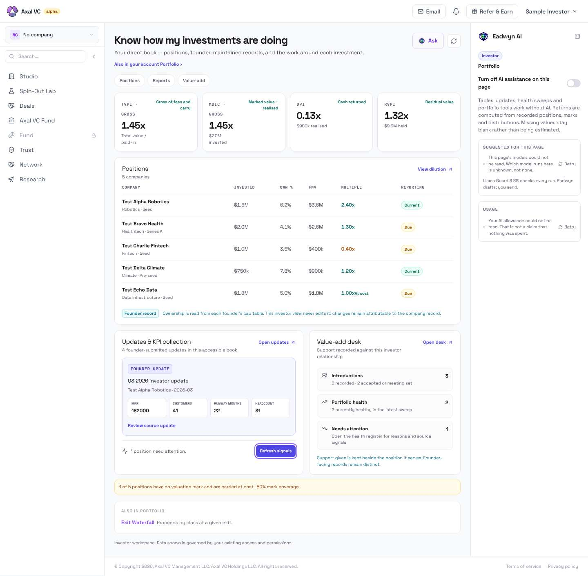
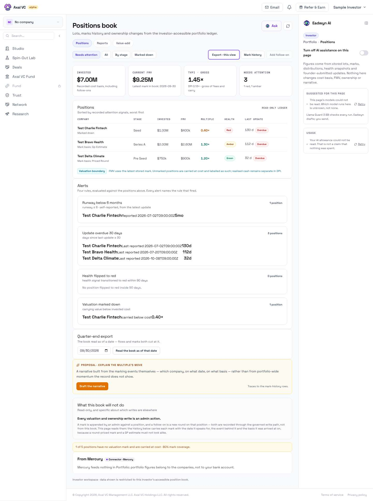
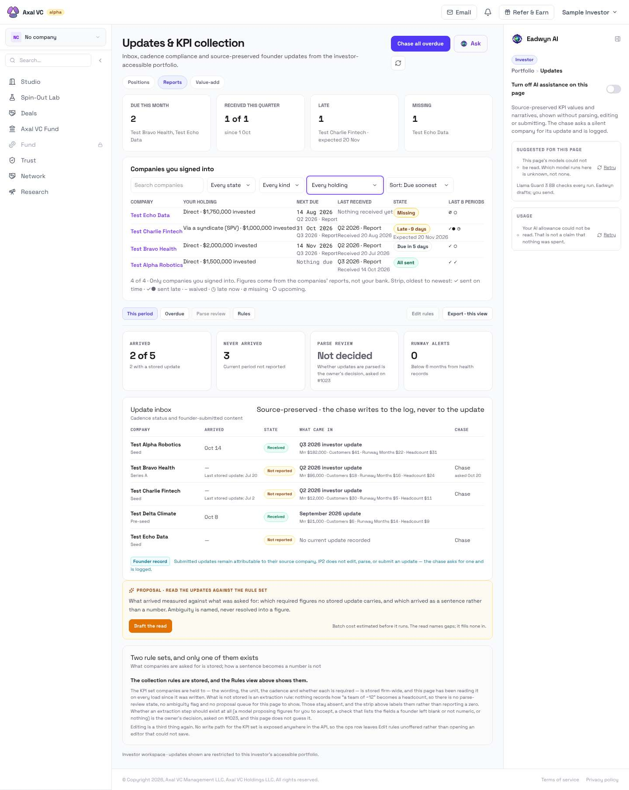
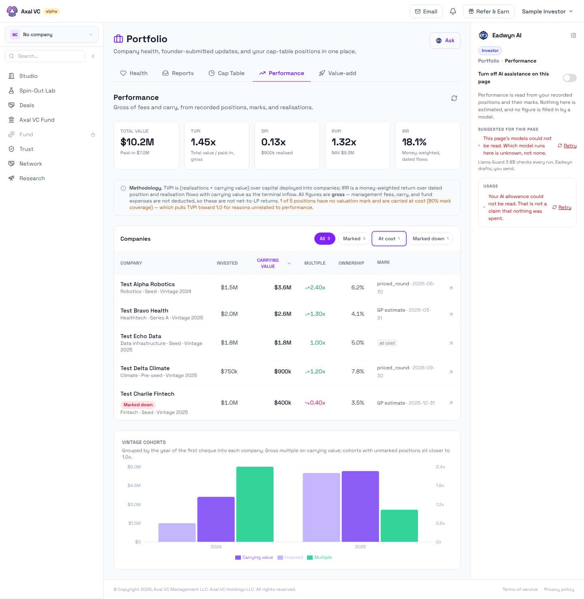
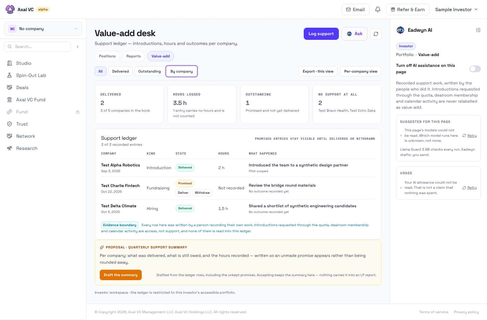
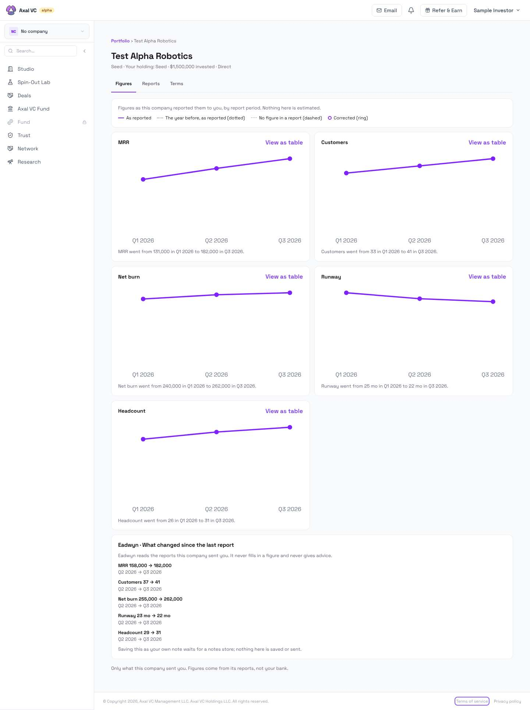
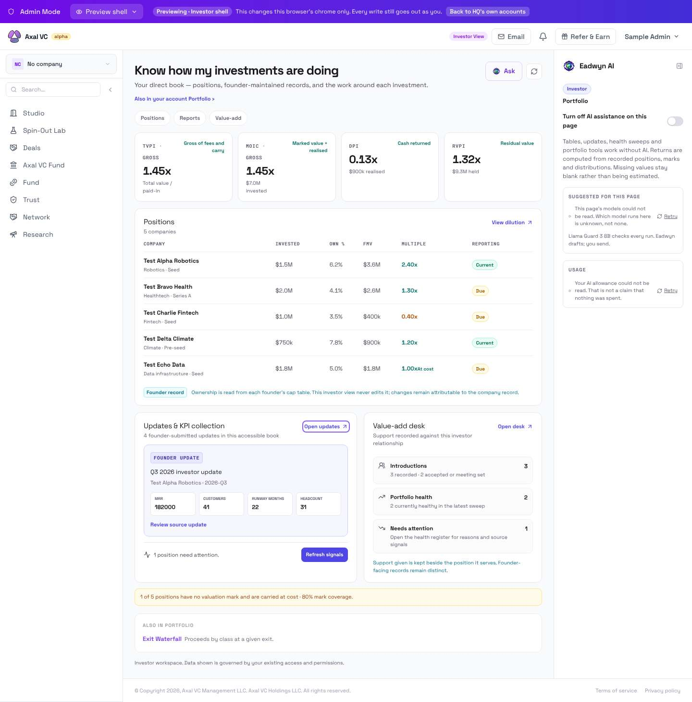
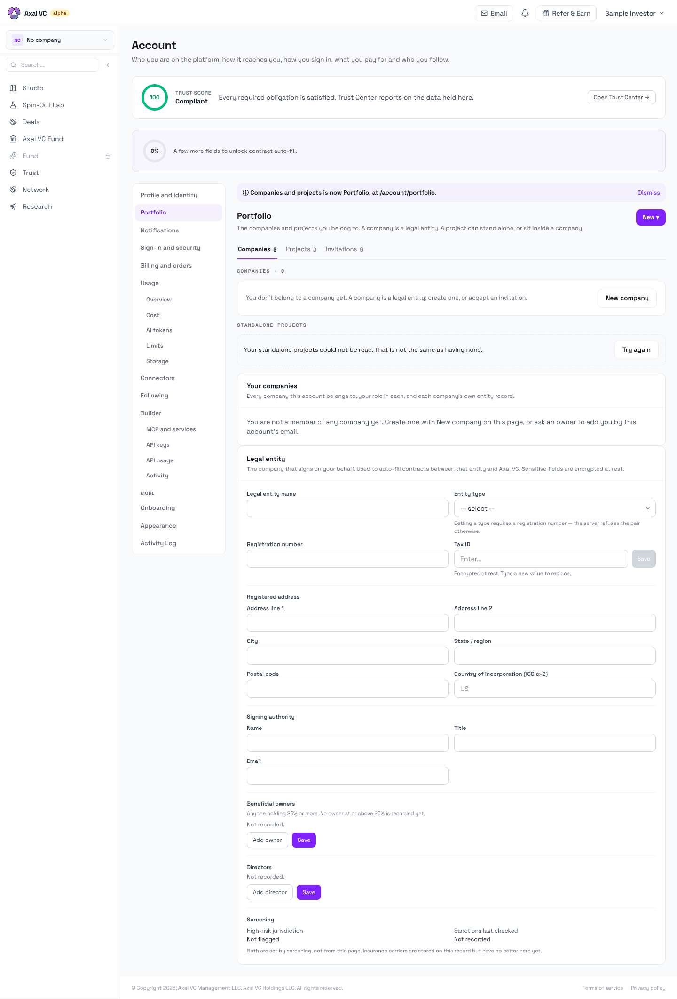

# Portfolio UI/UX audit — 2026-11-09 (#4816)

Audit of the signed-in investor **Portfolio** (`/portfolio` and everything under
it) on 9 November 2026, against `main` at `eaa046babc`. Part 1 of 3: #4817 owns
the redesign canvas (D4817), #4818 the build. This is a snapshot: it is true on
its date and is not maintained afterwards.

**How it was done.** The current SPA build (`docs/`, built from `main`'s
`frontend/` on the audit day) was served locally and opened in Playwright's
Chromium as a synthetic signed-in investor. Every `/api/*` call was answered
from invented fixtures shaped like the Worker's replies
(`portfolio-ux-2026-11-09/fixtures/portfolio.mjs`). No production account, data
or network was used. The script that produced every screenshot is
`portfolio-ux-2026-11-09/capture.mjs`; it can be rerun. Screens were taken at
1440×900 (desktop), 834×1112 (tablet) and 390×844 (phone), each grown to the
page's full height, and `screens/metadata.json` records each route's
`document.title`, meta description, canonical link, headings, landmarks and the
first 25 Tab stops.

**What this audit could not check** is listed in [§9 Limits](#9-limits). In
short: no production data, no production sign-in, no real admin-preview data
scoping, no screen reader, no colour-contrast measurement, no dark mode, and the
Eadwyn rail's own reads were left unanswered on purpose.

Each finding is labelled with where its evidence comes from:

- **Seen** — in the rendered current build, with synthetic data (a screenshot is cited);
- **Source** — read in the code only (a `file:line` is cited);
- **Seen + Source** — both.

A redesign idea is not listed as a defect unless a current screen supports it.

---

## 1. Screen inventory

Guards are from `frontend/src/App.jsx`. Every investor route below renders
inside `investorWorkspace('portfolio', …)` (`App.jsx:2477`), which returns the
page as-is for Portfolio (`InvestorWorkspacePage.jsx`, "Portfolio owns the
complete I4 composition").

| # | Route | Component | Guard | h1 (seen) | Local navigation | Rail | `document.title` (seen) |
|---|---|---|---|---|---|---|---|
| 1 | `/portfolio` | `pages/investor/InvestorPortfolioCanvas.jsx` (investor); `PortfolioHealthPage` in the tab shell for others | admin, founder, partner, investor (`App.jsx:3676`) | Know how my investments are doing | ZoneNav pills: Positions · Reports · Value-add, none current | Eadwyn (WorkerRail) | From idea to funded company — Axal VC StudioOS |
| 2 | `/portfolio/health` | same as 1 (legacy alias) | same (`App.jsx:3677`) | Know how my investments are doing | same | same | same |
| 3 | `/portfolio/positions` | `InvestorPortfolioPositions.jsx` | admin, investor (`App.jsx:3712`) | Positions book | ZoneNav, Positions current | Eadwyn | same |
| 4 | `/portfolio/updates` | `InvestorPortfolioUpdates.jsx` + `PortfolioReports.jsx` | admin, investor (`App.jsx:3707`) | Updates & KPI collection | ZoneNav, Reports current | Eadwyn | same |
| 5 | `/portfolio/performance` | generic `PortfolioWorkspace` + `PortfolioPerformancePage.jsx` | admin, investor (`App.jsx:3888`) | Portfolio (h2 Performance) | WorkspaceTabs: Health · Reports · Cap Table · Performance · Value-add (buttons) | Eadwyn | same |
| 6 | `/portfolio/value-add` | `InvestorPortfolioValueAdd.jsx` | admin, investor (`App.jsx:3889`) | Value-add desk | ZoneNav, Value-add current | Eadwyn | same |
| 7 | `/portfolio/companies/:uid` | `PortfolioCompanyPage.jsx`, Figures tab | admin, investor (`App.jsx:3709`) | company name | Breadcrumb "Portfolio ›" + tabs Figures · Reports · Terms | none | same |
| 8 | `/portfolio/companies/:uid/reports` | same, Reports tab | `App.jsx:3710` | company name | same | none | same |
| 9 | `/portfolio/companies/:uid/terms` | same, Terms tab | `App.jsx:3711` | company name | same | none | same |
| 10 | `/portfolio/waterfall` | `WaterfallPage` | admin, investor (`App.jsx:3699`) | not captured (see §9) | — | — | same (seen) |
| 11 | `/account/portfolio` | `SettingsPage` (Account › "Portfolio", menu label "Companies") | all member roles (`/account/:section`, `App.jsx:2714`) | Account | Account section list | none | same |

Page metadata (seen, `screens/metadata.json`): **every** route above has the
same title, the same marketing meta description ("Axal VC is a venture studio
platform: founders validate an idea…") and the canonical link `https://axal.vc/`.
The canvas asks for "Portfolio · Axal VC", "Positions · Portfolio · Axal VC",
"Northwind Labs · Portfolio · Axal VC" and so on (F-11).

Doors into Portfolio (source): the Account menu row "Portfolio" for an investor
(`App.jsx:904-907`); the Studio home tiles "Open Portfolio", one to `/portfolio`
and one to `/portfolio/performance` (`pages/studio/tiles/investorTiles.jsx:97,108`).
The investor sidebar did not show a Portfolio row in any capture (S01).

## 2. Journeys

Each journey lists the steps as a member would take them, what the screen shows,
and the findings it produced.

### J1 — "How is my portfolio doing, and what needs me?" (Overview)

1. Account menu → Portfolio → `/portfolio`.
   
2. First viewport (desktop, top 900 px of S01): title and intro, the
   "Also in your account Portfolio ›" link, three pills, four multiple cards
   (TVPI, MOIC, DPI, RVPI), then the start of the positions table. Nothing in
   the first viewport says what needs attention or when the figures were
   marked. The attention count sits in the lower right card, below the table
   (F-14, F-02, F-05).
3. Scan the table for a company to open. Names are plain text; nothing on this
   page opens a company (F-10).
4. Look for Performance. The pills offer Positions, Reports and Value-add only;
   the rail does not draw a door either (F-03).
   Tablet: [S01 tablet](portfolio-ux-2026-11-09/screens/S01-overview-tablet.jpg).
   Phone: [S01 phone](portfolio-ux-2026-11-09/screens/S01-overview-phone.jpg) —
   the positions table keeps only Company and Invested; the attention line is
   about 1,300 px down (F-20).

### J2 — "Which positions are marked, at what, and on what basis?" (Positions)

1. Overview → pill Positions → `/portfolio/positions`.
   
2. The register opens filtered to "Needs attention": 3 of 5 positions; the
   unmarked one is hidden (F-18).
3. Alerts lists four rules with raw timestamps (F-19); "Update overdue 30 days"
   flags a company the Overview calls Current (F-06).
4. Mark history: [S04](portfolio-ux-2026-11-09/screens/S04-positions-mark-history-desktop.jpg).
5. Partial source failure: [T07](portfolio-ux-2026-11-09/screens/T07-positions-partial-desktop.jpg)
   — cells say Unavailable and the count reads "≥ n" (a good pattern).

### J3 — "Who owes me a report?" (Reports)

1. Overview → pill Reports → `/portfolio/updates`, headed "Updates & KPI collection" (F-16).
   
2. Top half: "Companies you signed into" — obligations by signed duty, with Due
   / Received / Late / Missing tiles and company links.
3. Bottom half: "Update inbox" — a second, cadence-based model with Arrived /
   Never arrived, different counts and different company lists (F-06).
4. Chase: "Chase all overdue" primary button and per-row Chase.
5. Unreadable obligations: [T08](portfolio-ux-2026-11-09/screens/T08-reports-unreadable-desktop.jpg); empty: [T09](portfolio-ux-2026-11-09/screens/T09-reports-empty-desktop.jpg).
6. Internal copy visible to investors (F-09).

### J4 — "What are my returns, and how were they computed?" (Performance)

1. No Portfolio control leads here (F-03). Typed URL, or Studio tile "Open Portfolio".
   
2. A different shell: h1 "Portfolio", tab buttons Health · Reports · Cap Table ·
   Performance · Value-add (F-04). Total value, TVPI, DPI, RVPI and IRR, a
   methodology note, a company table with mark basis, vintage cohorts (F-25).
3. Empty book: [T12](portfolio-ux-2026-11-09/screens/T12-performance-empty-desktop.jpg).

### J5 — "What have we done for our companies?" (Value-add)

1. Overview → pill Value-add → `/portfolio/value-add`.
   
2. Primary "Log support"; tiles Delivered, Hours logged, Outstanding, No support
   at all; the ledger with Deliver / Withdraw on promised rows.
3. Unreadable ledger: [T10](portfolio-ux-2026-11-09/screens/T10-value-add-unreadable-desktop.jpg)
   — every tile says Unavailable and the sentence says no claim is made (the
   reference pattern for §6). Empty: [T13](portfolio-ux-2026-11-09/screens/T13-value-add-empty-desktop.jpg).

### J6 — "Open one company" (company workspace)

1. From Reports, click a company name (the only page whose names link).
   
2. Breadcrumb "Portfolio ›" returns to Reports, not to the Overview (F-16).
3. Tabs Figures · Reports · Terms ([S09](portfolio-ux-2026-11-09/screens/S09-company-reports-desktop.jpg),
   [S10](portfolio-ux-2026-11-09/screens/S10-company-terms-desktop.jpg)); no
   Portfolio navigation and no rail (F-17).
4. Not held: [S11](portfolio-ux-2026-11-09/screens/S11-company-not-held-desktop.jpg).
   Unreadable: [T11](portfolio-ux-2026-11-09/screens/T11-company-unreadable-desktop.jpg).

### J7 — Super Admin previewing the Investor shell

1. Admin with view mode Investor opens `/portfolio`.
   
2. The Portfolio overview renders (not Investor Studio home): #4849 is **not
   reproduced** with synthetic data.
3. Preview context is stated four times across two bars (F-12).
   Phone: [P01 phone](portfolio-ux-2026-11-09/screens/P01-admin-preview-overview-phone.jpg);
   company page: [P02](portfolio-ux-2026-11-09/screens/P02-admin-preview-company-desktop.jpg).

### J8 — Portfolio vs Companies

1. Account menu: "Companies" (`/account/portfolio`) and "Portfolio" (`/portfolio`) for an investor (`App.jsx:899-907`).
2. "Companies" opens a page whose section nav and heading say **Portfolio**, with
   the notice "Companies and projects is now Portfolio, at /account/portfolio."
   
3. The investment Overview links to it as "Also in your account Portfolio ›" (S01) (F-21).

### State captures (Overview)

| State | Desktop | Phone |
|---|---|---|
| Loading (positions read held open) | [T01](portfolio-ux-2026-11-09/screens/T01-overview-loading-desktop.jpg) | [T01](portfolio-ux-2026-11-09/screens/T01-overview-loading-phone.jpg) |
| Empty book | [T02](portfolio-ux-2026-11-09/screens/T02-overview-empty-desktop.jpg) | [T02](portfolio-ux-2026-11-09/screens/T02-overview-empty-phone.jpg) |
| Unreadable (positions 500) | [T03](portfolio-ux-2026-11-09/screens/T03-overview-unreadable-desktop.jpg) | [T03](portfolio-ux-2026-11-09/screens/T03-overview-unreadable-phone.jpg) |
| Partial (analytics, health, compliance 500) | [T04](portfolio-ux-2026-11-09/screens/T04-overview-partial-desktop.jpg) | [T04](portfolio-ux-2026-11-09/screens/T04-overview-partial-phone.jpg) |
| Not recorded (ownership, stage, IRR, 3 health snapshots absent) | [T05](portfolio-ux-2026-11-09/screens/T05-overview-not-recorded-desktop.jpg) | [T05](portfolio-ux-2026-11-09/screens/T05-overview-not-recorded-phone.jpg) |
| Stale (marks 16 months old, updates 7 months old) | [T06](portfolio-ux-2026-11-09/screens/T06-overview-stale-desktop.jpg) | [T06](portfolio-ux-2026-11-09/screens/T06-overview-stale-phone.jpg) |

## 3. Findings

Grades: **Critical** — the screen states something false about money or
holdings; **High** — a primary question cannot be answered, or two screens
disagree about a fact; **Medium** — friction, inconsistency or an accessibility
risk with a workaround; **Low** — polish.

| ID | Grade | Finding | Evidence |
|---|---|---|---|
| F-01 | Critical | When the positions read fails, the Overview shows the error banner **and** the empty book under it: "0 companies", "No direct positions have been recorded", "No intervention flags in the latest health sweep", zeros in Value-add. An unreadable book reads as an empty one. The banner also prints the server's raw `detail` text. | Seen T03 (desktop and phone). Source `InvestorPortfolioCanvas.jsx:117-119`: the body renders whenever `loading` is false, and `positions` stays `[]` after the catch at :69-71. |
| F-02 | High | No freshness on the Overview. "marks as of …" and the rail's mark date read `analytics.as_of`, which the Worker returns only when the caller passes `?as_of=`; the Overview never does, so no date is ever shown. A book whose marks are 16 months old looks identical to a current one. | Seen S01 vs T06 (no date anywhere). Source `InvestorPortfolioCanvas.jsx:40,126`; `cloudflare-worker/src/routes/positions.ts:266,300` (`as_of: asOf`, null without the query). |
| F-03 | High | Performance has no door inside Portfolio. The pills are Positions · Reports · Value-add (`shellConfig.js:253-266`). The Overview's rail link "Open performance methodology" is passed as `action`, a prop the rail no longer draws (`ui/WorkerRail.jsx:477`, `RETIRED_RAIL_PROPS`), so it is not on screen. The only doors are a Studio tile labelled "Open Portfolio" (`investorTiles.jsx:108`) and a typed URL. | Seen S01 (rail shows no link), S03, S05, S07. Source `InvestorPortfolioCanvas.jsx:186`. |
| F-04 | High | Performance renders in a second shell with a second vocabulary: h1 "Portfolio", tab buttons Health · Reports · Cap Table · Performance · Value-add, where "Health" is the Overview and "Cap Table" is Positions. The other four screens use pills Positions · Reports · Value-add. Moving between them changes the navigation under the member's hand. | Seen S06 vs S03. Source `PortfolioWorkspace.jsx:43-50,64-100`. |
| F-05 | High | Three answers to "what needs attention" for one book: Overview says 1 (health intervention flag only); Positions says 3 (red, amber, marked down or an update older than 30 days); Reports says Late 1 / Missing 1 in one half and Never arrived 3 in the other. | Seen S01, S03, S05. Source `InvestorPortfolioCanvas.jsx:85`; `InvestorPortfolioPositions.jsx:94-99`; `InvestorPortfolioUpdates.jsx:168-170`; `portfolioReportsModel.js:157-175`. |
| F-06 | High | Reporting is two models on one page, with conflicting facts. "Companies you signed into" (obligations from signed duties) omits a company with no duty and counts 1 missing; "Update inbox" (quarterly cadence) counts 3 never arrived. Positions' alert "Update overdue 30 days" flags a company the Overview's Reporting column shows as Current. | Seen S05 (Test Delta Climate absent above, "Received" below), S03 (Delta "32d" overdue), S01 (Delta "Current"). |
| F-07 | High | KPI values in the Reports inbox are all formatted as dollars: "Customers $41 · Runway Months $22 · Headcount $31". | Seen S05, T08. Source `InvestorPortfolioUpdates.jsx:26` (`kpiText` applies `money()` to every number). |
| F-08 | High | Health is not evidence-backed. With 3 of 5 companies carrying no health snapshot, the Overview says "No intervention flags in the latest health sweep" and "1 currently healthy", and shows no state for the other three. Only Positions says "Not recorded". (#4645 owns the per-company Not enough evidence / Unreadable states; this is how the gap shows today.) | Seen T05. Source `InvestorPortfolioCanvas.jsx:85,146,151-152`. |
| F-09 | High | Internal working copy is shown to investors: "Parse review · Not decided · Whether updates are parsed is the owner's decision, asked on #1023"; a card "Two rule sets, and only one of them exists"; "IP2 does not edit, parse, or submit an update"; "What this book will not do"; "From Mercury … Mercury feeds nothing in Portfolio". Issue numbers and canvas codes undercut institutional credibility. | Seen S05, S03. Source `InvestorPortfolioUpdates.jsx:189,192,209`; `InvestorPortfolioPositions.jsx:164`. |
| F-10 | High | Company names do not open the company workspace on the Overview, Positions, Performance or Value-add. Only Reports links names (`companyHref`). | Seen S01, S03, S06, S07 (names in plain ink; S05 in link colour). Source `InvestorPortfolioCanvas.jsx:130`; `InvestorPortfolioPositions.jsx:175`; `InvestorPortfolioUpdates.jsx:217`; `PortfolioReports.jsx:94`. |
| F-11 | Medium | No contextual titles or metadata: every Portfolio route is titled "From idea to funded company — Axal VC StudioOS", carries the marketing description and canonical `https://axal.vc/`. Two tabs on Positions and a company are indistinguishable in history, bookmarks and screen-reader page announcements. | Seen `screens/metadata.json` (all routes). Source `lib/seo.js` (`usePageMeta` resolves from the OG registry, which has no Portfolio entries). |
| F-12 | Medium | Admin preview states its context four times: "Admin Mode", "Preview shell", "Previewing · Investor shell" with a sentence, and an "Investor View" chip in the top bar, plus "Back to HQ's own accounts". The page beneath still says "Your direct book". | Seen P01. Whether the preview withholds private investor data could not be checked (§9). |
| F-13 | Medium | Partial failure is announced but not labelled where it lands: with analytics unreadable the four cards show "—" and "— invested", the same glyph the empty book shows (T02). The banner promises "Affected sections are labelled below". | Seen T04 vs T02. Source `InvestorPortfolioCanvas.jsx:15-21,89-92`. |
| F-14 | High | The first viewport does not answer the four questions in order. It leads with four multiples, two of which are the same number (TVPI and MOIC are both total value / paid-in), shows no NAV headline, paid-in, distributed or IRR (IRR is only on Performance), and puts the attention count in a side card below the table. | Seen S01 (top 900 px). Source `InvestorPortfolioCanvas.jsx:88-93`; `services/portfolioMetrics.ts:170-171`. |
| F-15 | Medium | Issue finding 9 as worded is not reproduced: the rail sentence "reads as absent rather than being carried at cost" is passed as a retired prop and not drawn. What remains visible is a softer tension: the rail says "Missing values stay blank rather than being estimated" beside an unmarked position shown at its cost, "1.00× At cost". The stale sentence is still in source. (#4644 owns the rule.) | Seen S01 (rail, row Test Echo Data, coverage band). Source `InvestorPortfolioCanvas.jsx:132,159-163,176,183`. |
| F-16 | Medium | One destination, four names: pill "Reports", h1 "Updates & KPI collection", rail crumb "Portfolio › Updates", address `/portfolio/updates`, Overview card "Updates & KPI collection · Open updates". The company breadcrumb "Portfolio" goes to `/portfolio/updates`, not to the Overview. | Seen S05, S01, S08. Source `PortfolioCompanyPage.jsx:113,132`. |
| F-17 | Medium | The company workspace is thin and detached: tabs Figures · Reports · Terms (no Overview, Support or Activity); no Portfolio navigation and no rail; the holding line repeats the stage ("Seed · Your holding: Seed …"); the five charts carry no axis values, so magnitude is only in the sentence beneath. | Seen S08, S09, S10. Source `pages/cycles/reportingModel.js:39-43,73-82`. |
| F-18 | Medium | The Positions register opens filtered to "Needs attention", hiding healthy and unmarked positions; the page called the authoritative register shows 3 of 5. | Seen S03. Source `InvestorPortfolioPositions.jsx:34`. |
| F-19 | Medium | Alerts print raw timestamps with no separator: "Reported 2026-07-02T09:00:00Z5mo", "Last reported 2026-07-20T09:00:00Z 112d". | Seen S03. Source `InvestorPortfolioPositions.jsx:324,332`. |
| F-20 | Medium | Phone: the Overview's table keeps Company and Invested only, so FMV, multiple, "At cost" and reporting state disappear; the header Ask button is clipped at the right edge; attention is ~1,300 px down. | Seen S01 phone. |
| F-21 | Medium | Portfolio vs Companies (#4473) is half done: the Account menu says "Companies", but the page it opens is headed and navigated as "Portfolio", with a notice "Companies and projects is now Portfolio", and the investment Overview links to it as "Also in your account Portfolio ›". | Seen S12, S01. Source `App.jsx:899-907`. |
| F-22 | Medium | Every Portfolio page except Performance has two `main` landmarks (shell and page), and there is no skip link: 15 Tab stops (top bar and sidebar) come before the page's first control. Focus styling was present on every Tab stop sampled. | Seen `metadata.json` (`mainCount: 2`, `tabStops`). |
| F-23 | Medium | The Overview's Value-add card counts introductions from `/api/introductions/` (3), while the Value-add desk it opens counts introductions in its own ledger (1). The two figures sit one click apart. | Seen S01 vs S07. Source `InvestorPortfolioCanvas.jsx:43,150`; `InvestorPortfolioValueAdd.jsx:73`. |
| F-24 | Low | Mark basis spelled four ways: "Gp Estimate", "Priced Round", `priced_round`, "GP estimate". | Seen S03, S06. Source `InvestorPortfolioPositions.jsx:24`. |
| F-25 | Low | Copy and number polish: "1 position need attention."; Overview KPI tiles print "182000" for MRR; vintage cohorts chart mixes dollars and a multiple on two axes with no values on the bars. | Seen S01, S06. Source `InvestorPortfolioCanvas.jsx:146`. |
| F-26 | Low | Error banners print the Worker's raw `detail` string to the member. | Seen T03. Source `InvestorPortfolioCanvas.jsx:69-71,117`. |

**What already works, and should be kept** (seen): the Unreadable wording on
Value-add (T10), Reports obligations (T08) and the company page (T11) — "…could
not be read. This is not a claim that …" with Retry; Positions' "≥ n" and
per-cell Unavailable under partial failure (T07); the mark coverage band (S01);
the methodology note on Performance (S06); the Reports obligation table with
search, filters and sort (S05).

### Issue-recorded findings of 7 November, re-checked

| # | Recorded finding | Result here | Evidence |
|---|---|---|---|
| — | #4849: admin investor preview showed Investor Studio home on `/portfolio` | **Not reproduced** with synthetic data: the Portfolio overview renders. Production not verifiable here. | P01 |
| 1 | Preview context repeated too many times | **Confirmed** | P01, F-12 |
| 2 | Portfolio (investment) vs Companies (`/account/portfolio`) | **Confirmed, partly fixed**: menu label fixed, page heading not | S12, F-21 |
| 3 | Navigation mixes ZoneNav, WorkspaceTabs, WorkerRail and page links; Performance reachable from the rail | **Confirmed, and worse**: the mix stands, and the rail link is no longer drawn, so Performance has no door in Portfolio | S01, S06, F-03, F-04 |
| 4 | Strong data, weak decision hierarchy | **Confirmed** | S01, F-14 |
| 5 | Health should be evidence-backed | **Confirmed** (gap) | T05, F-08 |
| 6 | Reporting should be obligation-first | **Partly**: an obligation table now leads Reports, but a cadence inbox with other counts follows, and the Overview's Reporting column is cadence-based | S05, F-06 |
| 7 | One company workspace (Overview · Financials · Reports · Support · Activity) | **Confirmed** (not met): Figures · Reports · Terms | S08, F-17 |
| 8 | Value-add as a first-class view | **Partly**: the desk is solid; the Overview card mixes sources | S07, F-23 |
| 9 | "At cost" label vs rail copy "absent rather than carried at cost" | **Not reproduced as worded**: the rail block is not drawn; the sentence remains in source and a softer tension is visible | S01, F-15 |
| 10 | Contextual browser titles | **Confirmed** | metadata.json, F-11 |

## 4. Information architecture proposal

One local navigation for every Portfolio screen, links with `aria-current`,
the same component on all five, and no destination reachable only from the
rail. Overview is a peer, not "above the zones".

```
Portfolio                                   title: <Screen> · Portfolio · Axal VC
├── Overview      /portfolio                (alias /portfolio/health → redirect)
├── Positions     /portfolio/positions
├── Reports       /portfolio/reports        (/portfolio/updates → redirect)
├── Performance   /portfolio/performance
└── Value-add     /portfolio/value-add

Portfolio › <Company>                       title: <Company> · <Tab> · Portfolio · Axal VC
├── Overview      /portfolio/companies/:uid
├── Financials    /portfolio/companies/:uid/financials   (today's Figures + investment history + marks)
├── Reports       /portfolio/companies/:uid/reports      (today's Reports + Terms' duties)
├── Support       /portfolio/companies/:uid/support
└── Activity      /portfolio/companies/:uid/activity     (backend required, D4817)
```

The address changes (`/portfolio/reports`, the company tab paths) are a
proposal for #4817/#4818 to settle; today's addresses must keep working.

**Overview, in decision order** (issue principle; D4817): 1. Performance —
NAV with mark coverage and as-of date, then TVPI, DPI, IRR, paid-in,
distributed, each with its basis. 2. Needs attention — one evidence-backed
queue with one action per company. 3. Companies — the dense table, name is the
link. 4. Reporting — obligations due and late. 5. Value-add — open
commitments.

| Screen | Primary action | Secondary actions |
|---|---|---|
| Overview | Open the top attention item's company | Open Positions / Reports / Performance; Refresh; Export |
| Positions | Open a company | Filter (default **All**), Mark history, Export this view, Read as of a date |
| Reports | Chase overdue (one or all) | Open a company's reports, Ask for a report, Waive a period, filter / search / sort, Export |
| Performance | Switch Chart / Table | Read as of a quarter-end, Methodology, Export |
| Value-add | Log support | Deliver / Withdraw an entry, By company, Export |
| Company › Overview | The next action named by its attention reason | Go to Financials / Reports / Support |
| Company › Financials | (read) | View as table, Mark history; admin-only Record a mark (D4817's Prepare → Review → Confirm → Receipt) |
| Company › Reports | Ask for the late report | Read a report, Waive a period |
| Company › Support | Record support for this company | Deliver / Withdraw |

Navigation rules: the Eadwyn rail is never the only way to a destination; every
company name in every Portfolio table links to its workspace; the company
breadcrumb returns to the screen the member came from, defaulting to Overview;
preview state is one banner (D4817 PF-08).

## 5. Vocabulary

| Use | Not | Where today |
|---|---|---|
| Portfolio (investments) | Direct book | `InvestorPortfolioCanvas.jsx` h1/intro |
| Companies (account surface) | Portfolio | Account › Portfolio heading (S12) |
| Positions | Cap Table, Positions book | Performance tabs, Positions h1 |
| Reports | Updates, Updates & KPI collection | Reports h1, rail crumb, Overview card |
| Overview | Health | Performance tabs, `/portfolio/health` |
| Needs attention | Intervention, Alerts | Overview health line, Positions Alerts |

## 6. State model

One vocabulary for every figure, row and panel. A state is decided from what
the read returned, never from what a figure looks like.

| State | Means | Decided from | Shows | Must not |
|---|---|---|---|---|
| Loading | The read has not answered | Request in flight | Skeleton in the panel's own shape, labelled `aria-busy`; the page frame and navigation stay usable (T01 is close) | Show zeros or an empty message |
| Empty | Read succeeded; nothing recorded yet | 200 with no rows | What will appear and how it gets there (T02 positions text is close) | Claim anything about other sources |
| Valid zero | Read succeeded; the value is 0 | 200 with `0` | `0` with its unit and basis | Render as "—" |
| Not recorded | Read succeeded; this field was never written | 200 with `null` for the field | The words "Not recorded" in the cell | "—" alone (T05), or 0 |
| Unreadable | The read failed | Non-2xx or network error | "X could not be read. This is not a claim that …" + Retry, in place of the panel (T08, T10, T11) | Render the empty state under it (F-01) |
| Partial | Some sources failed | Some reads failed | A banner naming the sources, **and** "Unavailable" in each affected figure (T07) | A banner with "—" below (F-13) |
| Stale | Read succeeded, but the value is older than its rule | As-of date vs the rule; D4817 draws marks older than two quarters as stale | The as-of date beside the figure and a "Stale" tag | Hide the date (F-02) |
| Not enough evidence | A judgement (health) cannot be made | No snapshot or too few inputs (#4645 decides) | "Not enough evidence" for that company | Count it as healthy or leave it blank (F-08) |
| Error (action) | A write failed | The write's refusal | What was not saved, what was kept, and what to do | Lose the draft |
| Private in preview | Admin preview withholds a block | Preview mode | One compact "Private in preview" chip | Repeat the preview explanation per block |

How #4636, #4642, #4644, #4645 and #4647 states should be communicated, without
redefining their contracts: each decides its own rule; the UI shows the result
in the vocabulary above, names the rule in a methodology or "why" line, and
never folds a failed read into an empty one.

## 7. Check against the Portfolio v2 canvas and D4817

`design/incoming/Portfolio v2 Page.dc.html` and `Portfolio v2 · Boards.dc.html`
(PF-01 to PF-12) cover most of the findings above: one local navigation (F-03,
F-04), Overview decision order and basis strip (F-02, F-14), evidence-backed
health with five states (F-08), obligations-first Reports with a report detail
(F-06), the five-tab company workspace (F-17), one preview banner (F-12), route
titles (F-11), stale marks (F-02), 17 states (F-01, F-13), tablet and phone
boards (F-20) and the accessibility notes (company name is a link, `aria-current`).
Where the canvas is silent, see §8.

## 8. Canvas gaps for #4817

Each item is something the current UI or #4816 requires that the canvas does
not draw or decide.

- **Terms has no home.** Today's company Terms tab carries the duties owed under
  signed documents (rule, clause, source document) and the investor's read-only
  cap-table panel (S10). The canvas company workspace has no Terms tab and does
  not say where duties, the document reference or the cap-table panel go.
- **Ask for a report and Waive a period** (company Reports, `CompanyReports.jsx`)
  are not drawn; the canvas shows chase history but not these two acts or their
  confirmations.
- **Holding route** (Direct / via an SPV / via an Axal VC fund / via a
  third-party fund) and its notes (`portfolioReportsModel.js` `HOLDING_NOTES`)
  are not drawn on the company header or the Reports table.
- **Company-reported figures** (five small multiples with View as table, the
  "What changed since the last report" read, corrected-report rings) — today's
  Figures tab (S08). The canvas Financials board shows investment history and
  marks; it does not say whether company-reported KPIs live there or elsewhere.
- **Exit Waterfall** (`/portfolio/waterfall`, linked from "Also in Portfolio")
  is not on any board.
- **Positions alerts and as-of export.** Today's four alert rules (runway under
  6 months, update older than 30 days, health turned red within 90 days, marked
  down) and the "Read the book as of a date" control (S03) are not mapped to the
  canvas's Needs attention queue. The canvas should say which rules feed the
  queue and that "overdue" means the reporting obligation, not 30 days (F-05, F-06).
- **Vintage cohorts and the per-company slide-over** on today's Performance
  (S06: mark history, realisations, rounds) are not drawn; the canvas should say
  keep, move to company Financials, or drop.
- **Addresses.** The canvas lists titles but not URLs for Reports and the
  company tabs; it should say whether `/portfolio/updates` and
  `/portfolio/health` redirect, and what the company tab paths are.
- **Titles for the remaining routes**: Reports, Value-add, company Overview,
  Reports, Support and Activity, the not-held page and the preview (only five
  titles are listed on PF-12).
- **Who else reaches `/portfolio`.** The route admits founders and partners
  (`App.jsx:3676`), who get the generic Health tab shell today; the canvas draws
  "Permission denied · Portfolio is for Investor licences". It should say which
  applies and whether the partner's Delivery link (`PortfolioWorkspace.jsx`) is retired.
- **Company not held** ("This company is not in your portfolio…", S11) and
  **company Unreadable** (T11) are not among the 17 states as drawn for the
  company workspace.
- **Overview → Companies cross-link.** Today's "Also in your account Portfolio ›"
  (D1413) is not on the canvas; say whether it stays and what it is called.
- **Eadwyn proposal bands** ("Draft the narrative", "Draft the read", "Draft the
  summary" on Positions, Reports and Value-add) are not drawn; the canvas says
  Eadwyn is never needed for navigation but not where these drafts live.
- **Value-add writes**: Deliver and Withdraw on a promised entry, and Log
  support's form with its Ask fill, are not drawn as states (validation, save
  failed).
- **Keyboard and landmarks**: no skip link and the nested `main` (F-22) are not
  covered by PF-12's accessibility notes.
- **Dark mode**: no dark board, while the shipped pages carry dark styles.
- **Loading per panel**: the canvas loading state is page-level; today the
  Overview reads five sources with independent outcomes (T04), and the canvas
  should show per-panel loading and failure on the Overview.

## 9. Limits

What these screenshots and this environment cannot prove:

- **No production data or sign-in.** Every figure is synthetic. Real books may
  be larger (pagination, long names, many companies) and real Worker replies may
  differ from the fixtures in fields the pages ignore.
- **Admin preview scoping.** The fixtures answered the admin the same as the
  investor. Whether production withholds private investor data in preview, and
  what `/api/positions` returns to an admin there, was not checked (source:
  `positions.ts:147` returns every recorded position to an admin). #4849's
  production behaviour is not verifiable here.
- **Eadwyn rail.** Its own reads (`/api/ai/*`, `/api/ai-budget/*`) were left
  unanswered, so "Suggested for this page" and "Usage" show Unreadable in every
  capture. That is a fixture artefact, not a finding.
- **Company Terms tab and cap-table panel** show fixture artefacts
  ("undefined days after year end", "The view could not be read") because the
  duty-rule and cap-table reads were not modelled. No finding is drawn from them.
- **Exit Waterfall** was not captured: its read was not modelled and the page
  failed on the stub's empty answer, which says nothing about production.
- **The build** is the `docs/` produced from `main`'s `frontend/` on the audit
  day; its exact commit was not stamped into the bundle.
- **Accessibility** checks were automated DOM reads only: headings, landmarks,
  25 Tab stops and computed focus styles on five desktop journeys. No screen
  reader, no contrast measurement, no zoom/reflow test, no reduced-motion or
  keyboard trap testing of dialogs.
- **Dark mode, other browsers, real devices** were not tested; tablet and phone
  are Chromium viewports.
- **Writes** (chase, log support, deliver, withdraw, ask, waive) were not
  exercised: the capture answers every non-GET with 405.
- **Correctness and security** of the figures and routes are out of scope
  (#4636, #4642, #4644, #4645, #4647).
